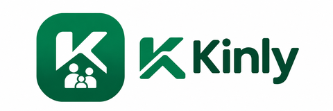
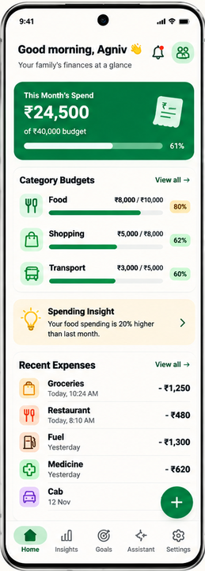
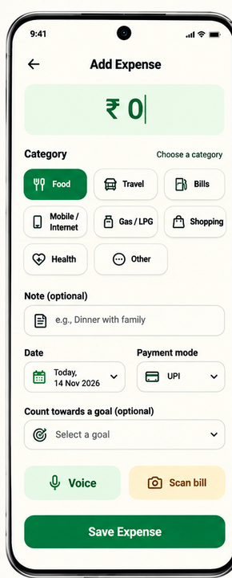
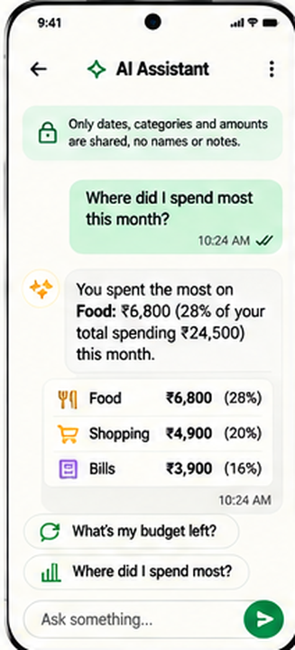
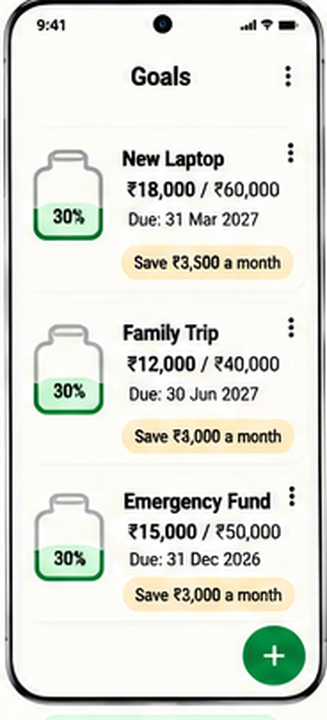
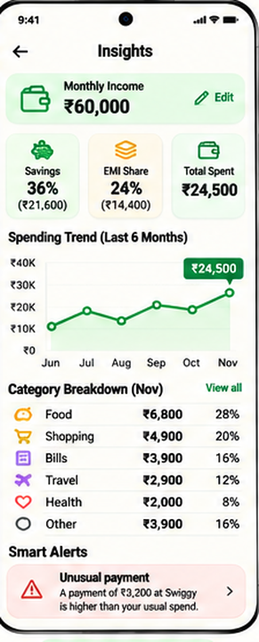
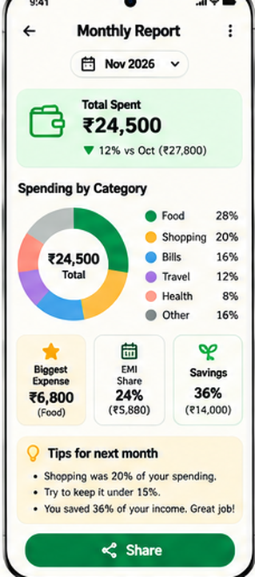

<p align="center">
  
</p>

<h1 align="center">Kinly</h1>

<p align="center">
  <b>Family expense, EMI and loan tracker for Indian households.</b><br>
  Track spending together, never miss an EMI, and get simple saving tips.
</p>

<p align="center">
  <a href="https://github.com/AGNIV33/Money-Management-APP/releases/latest"><b>⬇️ Download the latest APK</b></a>
</p>

> ⚠️ **Early test version (pre-release).** Kinly is still being tested on real phones. Some features may have bugs.
> Please report problems in [Issues](https://github.com/AGNIV33/Money-Management-APP/issues).

---

## Contents

- [App preview](#app-preview)
- [What Kinly does](#what-kinly-does)
- [Requirements](#requirements)
- [How to install](#how-to-install)
- [How to update](#how-to-update)
- [Is it safe?](#is-it-safe)
- [Your privacy](#your-privacy)
- [Permissions the app asks for](#permissions-the-app-asks-for)
- [Common questions](#common-questions)
- [For developers](#for-developers)

---

## App preview

<p align="center">
  
  
  
</p>
<p align="center">
  
  
  
</p>
<p align="center"><sub>Home · Add expense · AI Assistant · Goals · Insights · Monthly report<br>
<i>Design previews. The real app may look slightly different.</i></sub></p>

---

## What Kinly does

### 👨‍👩‍👧 Family money in one place
- **Family group:** create a family and invite up to 4 members with a code.
- **Add expenses fast:** amount, category, date, who paid and payment mode (Cash / UPI / Card).
- **"Family" or "Only me":** choose for each item whether the whole family can see it or only you.
- **Works offline:** add things without internet. They sync when you are back online.

### 📊 Budgets and insights
- Monthly family budget, with alerts at 80% and 100%.
- Home dashboard: this month's total, compared with last month, top categories and budget left.
- Spending trends and patterns, worked out on your phone.
- **AI monthly report card:** 3 to 5 simple saving tips once a month.

### 🏦 EMIs, loans and udhaar
- **EMI and loan manager:** paid vs remaining, progress bar and next due date.
- **EMI reminders:** 3 days before, 1 day before and on the due day.
- **Udhaar:** track who owes you and whom you owe, with part payments.
- **Calculators:** basic calculator, EMI calculator, prepayment saver and "Can I afford this loan?".

### 🎯 Goals and recurring costs
- **Saving goals** with a progress jar.
- **Recurring expenses** like rent, maid, milk and internet, added automatically.

### ✨ Smart helpers
- **Voice entry:** say *"aaj 200 ka doodh"* and it fills ₹200, Milk, today. Works in Hindi, English and Hinglish.
- **Bill scan:** take a photo of a bill and it reads the total, date and shop.
- **Auto category:** suggests a category from the note or shop name. Runs on your phone.
- **Passbook import:** upload a bank statement photo or PDF to find expenses you forgot to add. You review every line before anything is saved.
- **AI Assistant:** ask money questions like *"What's my budget left?"* by typing or by live voice talk.

### 🔒 Security
- App lock with fingerprint or phone PIN.
- Login with an email code (OTP) or Google.
- English and Hindi languages.

---

## Requirements

| | |
|---|---|
| **Phone** | Android 8.0 or newer |
| **Internet** | Needed for login, family sync and AI features. Everything else works offline. |

---

## How to install

1. On your Android phone, open the **[Releases page](https://github.com/AGNIV33/Money-Management-APP/releases/latest)**.
2. Under **Assets**, tap the file named **`Kinly-vX.X.X.apk`** to download it.
3. Open the downloaded file. If the phone asks, allow **"Install unknown apps"** for your browser or file manager.
4. If you see **"Scan with Play Protect"**, tap **Scan app**, then **Install**. (Read why in [Common questions](#common-questions).)
5. Open Kinly and log in with your email or Google.

---

## How to update

- Download the newer APK from the Releases page and open it. Tap **Update**.
- You **don't need to uninstall** first. Your data stays.

---

## Is it safe?

- Every APK is **signed with the same Kinly key**, so Android only lets real Kinly updates install over each other.
- Each release lists the file's **SHA-256** and the signing certificate's **SHA-256**, so you can check that your download wasn't changed.
- Kinly only uses the internet for login, family sync and AI features. It never asks for SMS or contacts.

---

## Your privacy

- **Your family's data is only visible to your family.** The database blocks everyone else (row-level security).
- **"Only me" items stay private,** even from your own family members.
- **The AI only sees totals.** It gets dates, categories and amounts. It never gets names, notes, phone numbers or account numbers.
- **The AI Assistant does not store** what you say or type.
- Account numbers in imported statements are hidden on your phone before anything is sent.
- If crash reporting is turned on in a build, app crash details are sent to Sentry so bugs can be fixed.
- AI features use Google Gemini's free tier. Google may use that data to improve its services. The app tells you this before you use the assistant for the first time.

---

## Permissions the app asks for

| Permission | Why |
|---|---|
| Internet | Login, family sync and AI features |
| Camera | Scanning bills and passbooks (only when you tap scan) |
| Microphone | Voice entry and the AI Assistant (only when you tap the mic) |
| Notifications | EMI reminders and budget alerts |

---

## Common questions

**Why does Android say "Scan with Play Protect"?**
Kinly isn't on the Google Play Store yet. Android shows this for apps from new developers installed from outside the Play Store. Tap **Scan app**, then **Install**.

**Is Kinly free?**
Yes, this test version is free.

**Does it work without internet?**
Yes, for adding and viewing expenses, loans, goals and calculators. Login, family sync and AI features need internet.

**The AI Assistant says "busy today". Why?**
There is a daily free limit for AI use. Try again tomorrow.

**I found a bug. What should I do?**
Open an [Issue](https://github.com/AGNIV33/Money-Management-APP/issues) and include your phone model, Android version and what happened. Add a screenshot if you can.

---

## For developers

Native Android app (Kotlin, Jetpack Compose, Material 3), offline-first, built for low-end phones. Backend: Supabase (Auth, Postgres with RLS, Edge Functions).

Start with `CLAUDE.md`, then the docs in `DOCS/`: `PRD.md`, `ARCHITECTURE.md`, `DESIGN.md`, `IMPLEMENTATION_PLAN.md`, `TESTING.md`.

### Build
```bash
./gradlew assembleDebug        # debug APK
./gradlew test                 # unit tests
./gradlew ktlintCheck detekt   # lint
./gradlew :app:assembleRelease # signed release APK (needs keystore.properties)
```
On Windows, use `gradlew.bat`.

### Local setup (never committed)
- `local.properties`: `sdk.dir`, `SUPABASE_URL`, `SUPABASE_ANON_KEY`. Optional: `SENTRY_DSN` turns on crash reports in release builds (left empty = no reports).
- `keystore.properties` (only for release builds): `storeFile`, `storePassword`, `keyAlias`, `keyPassword`.

### Font
The app uses the Inter font, under the SIL Open Font License (`DOCS/licenses/Inter-OFL.txt`).
